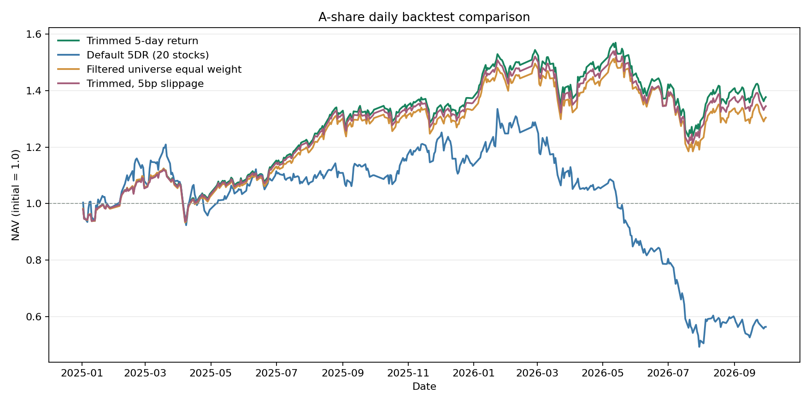
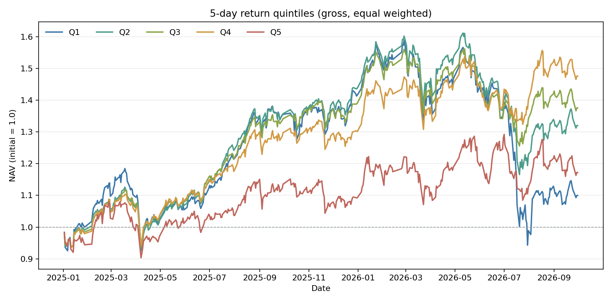

# A 股日频回测作业报告

## 实验口径

- 数据：课程 Feather 全市场矩阵，5,451 只证券；回测区间 2025-01-02 至 2026-09-30。
- 信号锚点：2024-12-31 收盘；次交易日开盘建仓；之后每 5 个交易日收盘更新一次信号。
- 清仓：2026-09-29 收盘发出零仓位目标，2026-09-30 开盘执行；剩余可交易持仓在 9 月 30 日收盘按剩余容量尝试清仓。
- 资金及约束：初始资金 ¥1,000,000,000；买入 100 股整手；每只证券每日买卖合计不超过前一交易日成交额的 10%。
- 费用：佣金单边 1 bp、无最低佣金；卖出印花税 5 bp；主结果滑点 0 bp。
- 股票池：上市至少 60 个交易日；按前一交易日成交额剔除候选池中流动性最低 20%；信号日有有效行情和成交。
- ST 推断：课程矩阵没有 ST 标记。使用无未来信息的规则：60 个交易日内两次出现 ±5% 一字板，则从第二次起推断为 ST 并持续剔除。它不是官方历史 ST 名单。

## 策略

主策略每 5 个交易日计算复权 5 日收益，剔除收益最高和最低的各 10%，其余证券等权持有。运行时参数固定为：5 日窗口、两端各 10%、60 日上市期、成交额最低 20% 过滤、10% 单股成交容量。此包没有声称做过训练期网格搜索；参数按提交规格固定，结果为 2025–2026 样本外区间的实跑结果。

对照组使用相同区间、股票池、调仓节奏、资金、费率、容量及涨跌停/T+1 规则：系统默认 5DR 反转策略（20 只）和合格股票等权基准。另运行主策略 5 bp 滑点敏感性。

## 实跑结果

| 策略 | 总收益 | 年化收益 | 最大回撤 | 夏普 | 期末净值 | 期末持仓市值 |
|---|---:|---:|---:|---:|---:|---:|
| 主策略（剔除两端极值） | 37.71% | 20.17% | -21.20% | 1.02 | ¥1,377,128,542 | ¥4,135,009 |
| 系统默认 5DR（20 只） | -43.63% | -28.05% | -63.10% | -0.78 | ¥563,675,244 | ¥183,561,714 |
| 合格股票等权基准 | 30.43% | 16.48% | -21.87% | 0.85 | ¥1,304,304,542 | ¥4,809,604 |
| 主策略（5 bp 滑点） | 34.51% | 18.56% | -21.40% | 0.96 | ¥1,345,088,242 | ¥4,071,004 |

相对等权基准超额：7.28%。主策略 5 bp 滑点相对基础情形少 3.20%。调仓日平均合格证券 3,820 只，主策略平均持有 3,057 只。

五层因子诊断期末毛收益：Q1 9.98%、Q2 32.04%、Q3 37.58%、Q4 47.62%、Q5 17.23%。Q1 到 Q5 按复权 5 日收益从低到高分组。

## 实现与可复核材料

- `quantbt.py`：撮合引擎，支持 T+1、整手、涨跌停、受阻订单重试、容量约束、费率和期末清仓。
- `assignment_backtest.py`：按以上固定口径运行三组策略和 5 bp 敏感性对照。
- 每个结果子目录提供 `nav.csv`、`trades.csv`、`trade_summary.csv`、`metrics.json`、`run.json` 和净值图。
- `comparison.csv` 汇总四组结果；`run.json` 记录参数、数据文件快照、ST 推断和每次调仓股票数量。逐笔委托文件按每次尝试记录，受阻订单会重试，因此它的行数不是唯一委托数。

## 结果限制

ST 识别是 OHLCV 价格行为推断，可能漏判或误判；它不能替代官方逐日 ST 名单。退市和长期停牌股票会按原始日线保持持仓，订单无法成交时继续记录阻塞。日线数据不含盘口队列，涨跌停和容量撮合仍是近似。固定费率不代表历史费率。策略参数按用户给定规格固定，未做 2020–2023 调参验证，也不应把这组回测结果解释为显著超额或收益保证。
